# HomePad

HomePad turns an iPad into an always-on home display in the spirit of Apple HomeView (announced October 2026). It does everything HomeView does on the iPads you already own, and goes further:

- Any AI provider, from Apple Intelligence on device to Claude, ChatGPT, Gemini, Grok, Meta Muse and local models.
- HomeKit and Home Assistant side by side.
- Messages as each person's own Apple ID, through a Mac.
- The Face ID camera for presence sensing that works in the dark.
- Back-camera tools HomeView cannot have, such as a security camera and a LiDAR floor plan.
- A real kiosk mode.

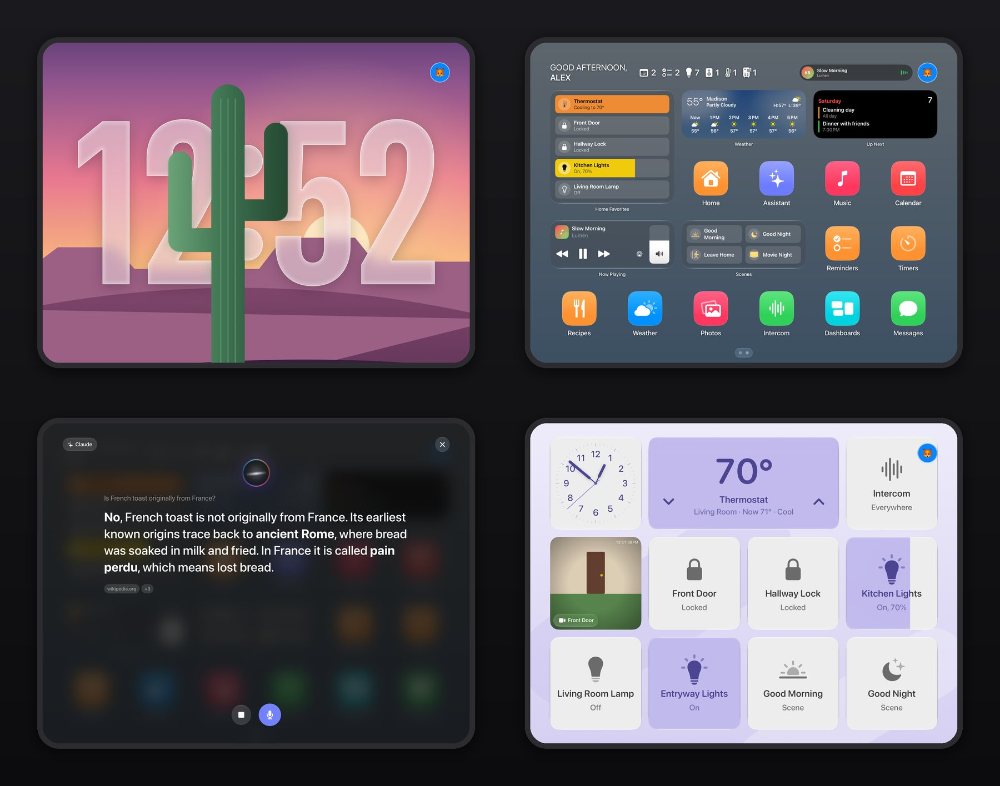

The same app runs on iPhone and Mac as a companion remote, and there is an Apple Watch intercom.

**Contents:**
[Install](#install-on-an-ipad) ·
[Always on](#make-it-always-on) ·
[Faces](#faces) ·
[Distance and night](#it-knows-how-far-away-you-are) ·
[Home Screen and people](#a-home-screen-for-each-person) ·
[Control Center and kiosk](#control-center-and-kiosk-mode) ·
[Assistant](#an-assistant-with-any-ai) ·
[Smart home](#homekit-and-home-assistant) ·
[Music and AirPlay](#music-airplay-and-airpods) ·
[Presence](#presence-sensing-with-the-face-id-camera) ·
[Kitchen](#kitchen) ·
[Calendar, photos and Find My](#calendar-reminders-weather-photos-and-find-my) ·
[Messages](#messages-through-your-mac) ·
[Camera Lab](#camera-lab-back-camera-tools) ·
[Across your devices](#across-your-apple-devices) ·
[Develop](#develop)

## Install on an iPad

Requirements: Xcode 27, an iPad on iPadOS 26 or later, and Kyle's developer team (`35UB6472YK`, already set in `project.yml`).

1. Plug the iPad into the Mac with a cable and unlock it. Tap **Trust** if asked.
2. On the iPad, turn on **Settings > Privacy & Security > Developer Mode** and restart if prompted. The option appears after the iPad has been connected to Xcode once.
3. In Terminal:
   ```
   cd ~/homepad
   make devices                      # find the iPad's identifier
   make device DEVICE=<identifier>   # registers the iPad with the team, builds (Release), installs, launches
   ```
   Or open `HomePad.xcodeproj` in Xcode, pick the iPad as the run destination, and press Run.
4. The first launch walks through onboarding: household name, people, sensors, AI provider and smart home.

Development-signed builds stay valid for a year on the paid team, then need a rebuild.

**One-time portal step for Apple Music:** in the Apple Developer portal, open Identifiers, select `com.ksha23.homepad`, and turn on **MusicKit** under App Services. Without it, Apple Music search and playback fail, while radio and sleep sounds still work.

## Make it always on

- Keep the iPad on power. Turn on the battery charge limit (Settings > Battery) to protect the battery.
- **Guided Access** keeps HomePad in front: Settings > Accessibility > Guided Access, then triple-click the top button inside HomePad.
- **Shortcuts automation**: in Shortcuts, add a personal automation that opens HomePad when the charger connects.
- **Single App Mode** (strongest lock): supervise the iPad with Apple Configurator and allow `com.ksha23.homepad`. HomePad can then lock itself in with the button in Settings > Kiosk & Display.

The Kiosk & Display settings pane explains each option and shows its status.

## Faces

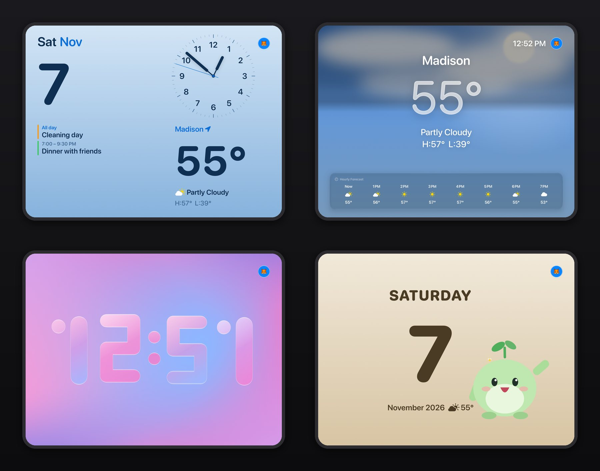

The face is what the iPad shows when nobody is using it. There are fifteen:

- **Modular** (the default): date, clock, weather and today's events.
- **Photos**: a slideshow of favorites, an album or an iCloud Shared Album (photos only, no videos), with a large time drawn behind the people in the photo.
- **Home**: tiles for favorite accessories, cameras, scenes and Intercom.
- **Cameras**: live video from up to nine cameras.
- **Weather**: an animated sky for the conditions and time of day.
- **Calendar**: a month grid with today's events.
- **Flow**: generative color that moves toward you as you approach.
- **Clock faces**: Analog, Numerals, Digital, Fade (a sundial) and World Clock.
- **Night**: a dim red clock for bedrooms.
- **Critters**: Sprig, an original sprout creature who sleeps, reads, holds an umbrella in the rain and cheers when a timer finishes.
- **Smart Rotation**: picks a face for you, such as Cameras when the doorbell rings, Night at night, or your own face when you walk up.

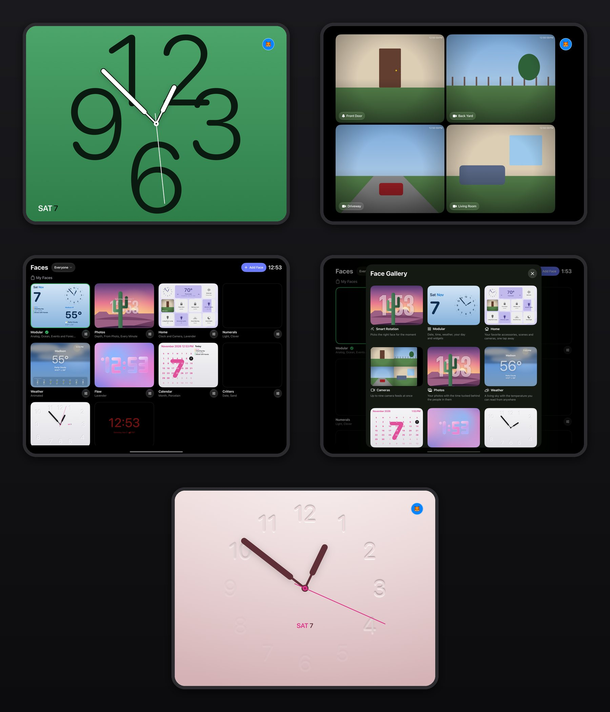

Swipe sideways on the face to go to your next saved face. The faces page like the Home Screen: the face follows your finger, a short swipe springs back, and past the last face comes the first again.

Hold the face to open the Faces app. Customize faces the way you would on Apple Watch: swipe through styles, pick background, text and accent colors from a fixed palette, and tap a slot to choose a city, an accessory or a camera. Each person keeps a "My Faces" list.

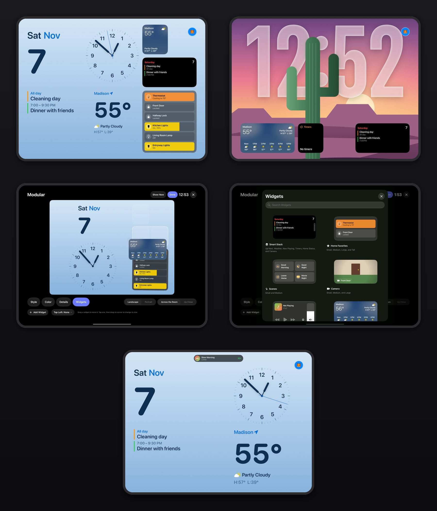

Put widgets on any face and arrange them on the face itself, like the iPad's Home Screen:

- Each face has a grid of six by four cells in landscape and four by six in portrait. A widget takes one cell, two side by side, two by two, or two wide and three tall. The tall size is for Home Favorites, Up Next and Reminders, which show more in it.
- In the face editor's Widgets page, drag a widget to move it, drag its corner to resize it, and add more from a gallery of live previews.
- Widgets never cover the time, and they stay at every distance. Landscape and portrait each keep their own arrangement.
- While a timer runs or music plays, the timer and Now Playing pills show at the top of the face, and the face makes room for them.

## It knows how far away you are

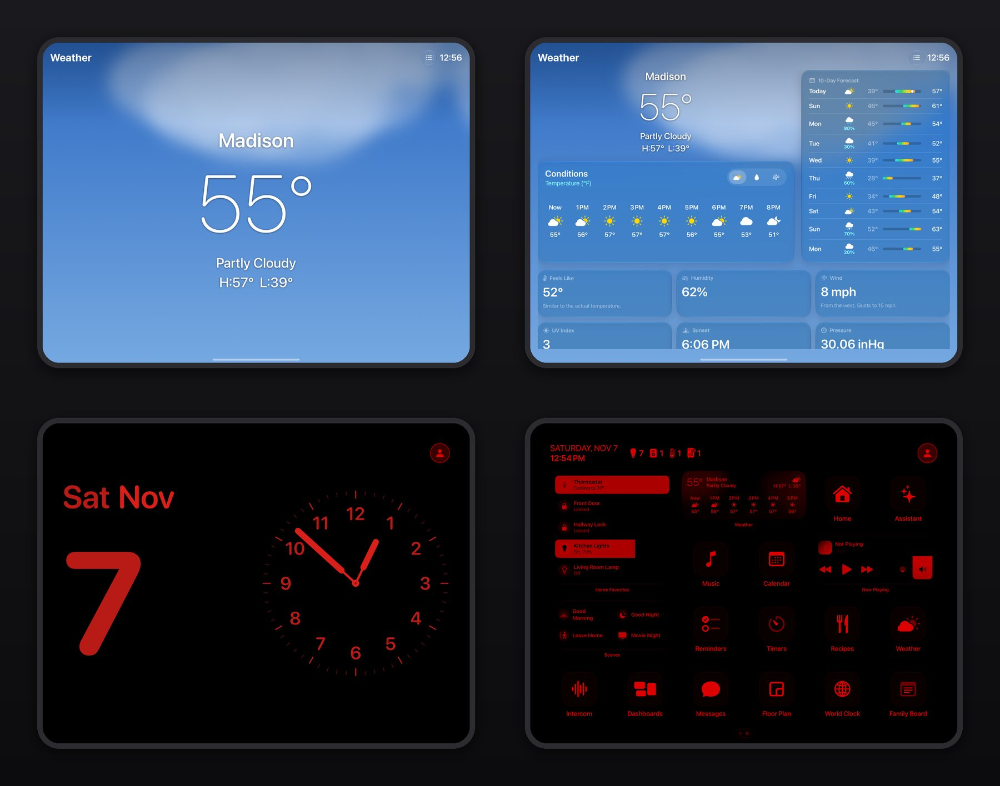

- From across the room, screens show big glanceable information. Walk up and they add detail: the hourly forecast, the next steps of a recipe, the times on camera feeds.
- On faces, the big fact glides smaller and aside as you walk up, and the detail fades in once it has made room. Every face moves on the same curve.
- Controls are sized for someone walking up to the iPad, not sitting at it: every control on an app screen, panel or widget is at least 64 points, and the main control of a screen is larger.
- In a dark room or at night, everything turns a dim red so the iPad never lights up a bedroom. App icons go dark with a light symbol.
- When nobody has been around for a while, the screen sleeps. It wakes when someone approaches, the doorbell rings, a timer finishes or someone talks to it.

## A Home Screen for each person

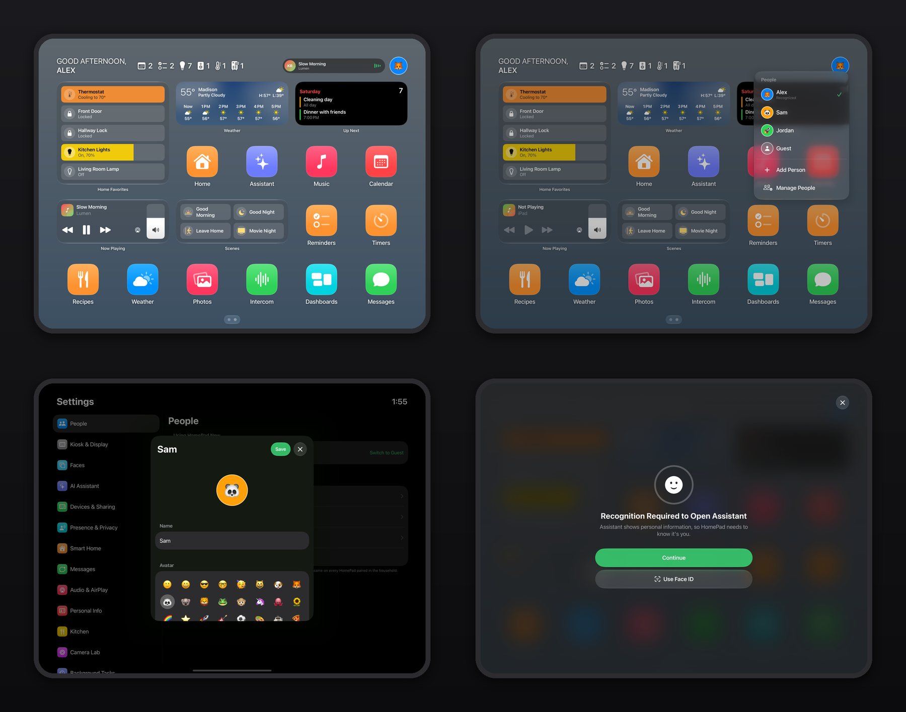

- Up to six people. Each gets their own Home Screen, wallpaper, accent color, face and assistant.
- HomePad recognizes people by face on the iPad itself. Personal content such as calendars, reminders and assistant history stays hidden until its owner is recognized. "Use Personal Device" asks your paired iPhone instead, where you approve with Face ID, and "Use Face ID" on the iPad works too.

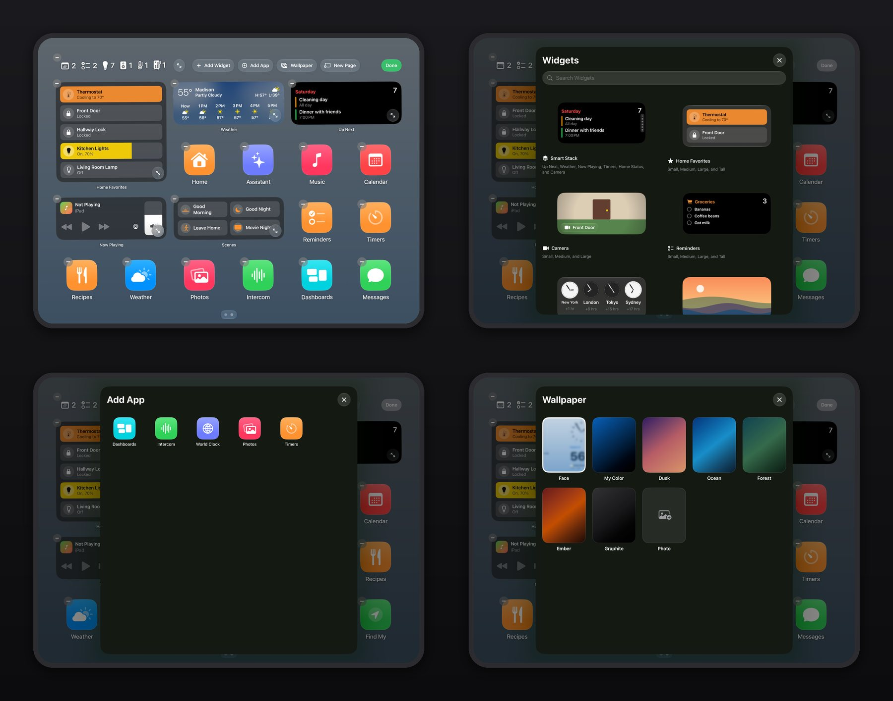

- Edit the Home Screen like an iPad: long-press to jiggle, drag to reorder, and add widgets in small, medium, large and tall sizes from the gallery, or apps that are not on it yet.
- Tap a widget while the Home Screen jiggles to edit it, as on iPadOS: pick which controls Home Favorites shows and in what order, or which list a Reminders widget follows. Each widget keeps its own settings, so two Reminders widgets can show Groceries and Errands. On a face, select the widget in the face editor and tap Edit Widget.
- The Home Screen sits on your face behind frosted glass, as on HomeView. The face behind it keeps its up-close look, so nothing shifts behind the icons as people move around. Long-press, then tap Wallpaper to pick a gradient or a photo instead.
- In Dark, a bright wallpaper or face is dimmed until the Home Screen reads as dark, more for a brighter picture, and a dark one is left as it is. Widgets on it turn dark to match.
- Apps open out of their icon and close back into it, as on iPadOS, with the Home Screen sitting back behind them. The last eight apps stay suspended, so they come back exactly as you left them, scrolled to the same place.
- Every app also reopens where you left it after HomePad restarts: Calendar in week view on the week you moved to, Reminders on your list, Photos in your album, Home on its room, Settings on its pane. Personal apps remember each person separately, and a date goes back to today after a few hours.

## Control Center and kiosk mode

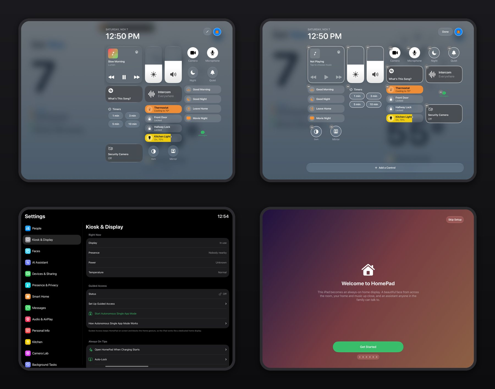

- Pull down from the top-right corner for Control Center: Now Playing, brightness, volume, camera and microphone privacy switches, night mode, quiet hours, Mirror, and tiles from every module.
- Customize Control Center like iPadOS: in edit mode the controls hold still with pulsing outlines (the Home Screen wiggles instead), a translucent minus removes one, and a short press moves one.
- Pull down from the top for the assistant. Swipe up to go home. Swipe down on a full-screen view, such as a photo, a camera, an accessory's controls or Now Playing, to close it back to where you opened it.
- The kiosk controller keeps the screen awake, ramps brightness by time and room light, slowly drifts the face so the OLED panels on newer iPad Pros never burn in, and warns when the iPad is not charging.

## An assistant with any AI

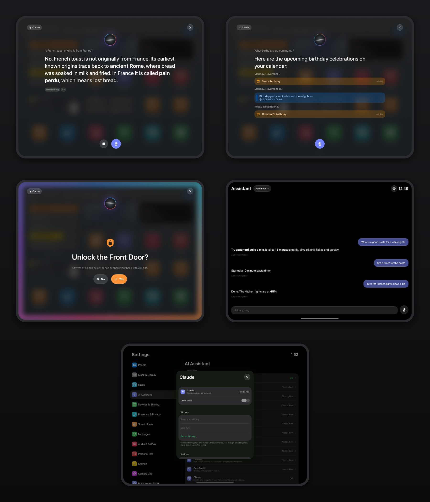

- Providers: Apple Intelligence on device, Claude, ChatGPT, Gemini, Grok, Meta Muse, Mistral, DeepSeek, Groq, Perplexity, OpenRouter, and local models through Ollama or LM Studio. If one fails, the next one answers.
- Say "Hey HomePad" or pull down from the top. Speech is recognized on the iPad, and answers are spoken sentence by sentence as they stream. Say "stop" or tap to interrupt.
- It can see and do things: control several devices at once ("lights off and the thermostat to 68"), run scenes, check the weather and calendars, add reminders, start timers, set alarms, play music and announce over intercom.
- It knows what is on screen. Say "unlock this door" while a camera is up, or "add these ingredients to my shopping list" on a recipe. Personal screens, such as a calendar day, count only once you are recognized.
- Answers show the facts that answer the question in bold, as on HomeView, with their sources as small chips.
- Unlocking doors, opening garages and disarming alarms always ask first. Answer by tapping, saying yes or no, or nodding with AirPods.
- Each person can pick their own provider and model, and add a short "About me" for context.

## HomeKit and Home Assistant

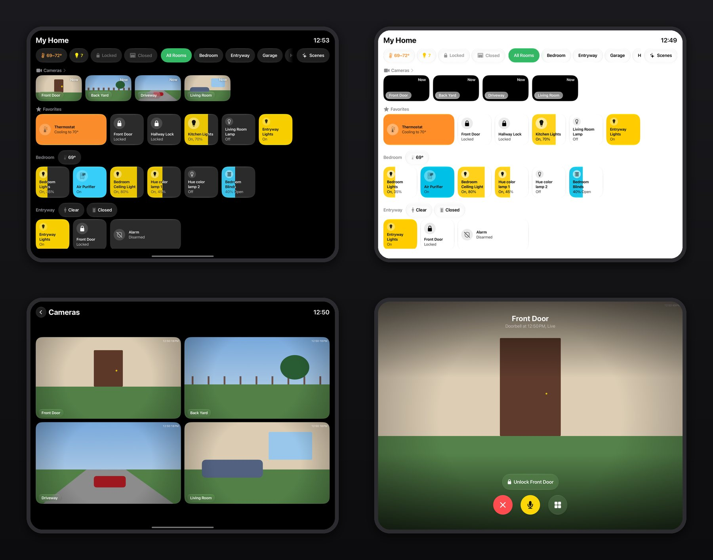

- One Home app for Apple Home and Home Assistant together, laid out like HomeView's: cameras, scenes, favorites and rooms, each room's sensor readings beside its name, and full-screen controls for lights, thermostats, locks, blinds, fans and speakers. A light's controls are one big slider you can work from a step back, and a swipe down closes them.
- Cameras live in the Home app, as on HomeView: a row of snapshots, a live grid of up to nine, and full screen with talk. A doorbell screen pops up with talk and "Unlock Front Door" when someone rings.
- Home Assistant connects with a long-lived token through HAKit, Home Assistant's own Swift library. HomePad finds Home Assistant on your network automatically.
- Dashboards shows Home Assistant's own dashboards inside HomePad, styled to match, so every custom card you already have works.
- Home Assistant's device trackers and zones power Find My, and its notify and iCloud actions play a sound on a lost device.
- Each HomePad can be a device in Home Assistant, off until turned on in Settings > Smart Home: presence, distance, who is recognized, room light, the screen, face, app, brightness and battery as sensors, and automations that show a camera, sleep or wake the screen, open an app or speak through `notify.mobile_app_<device>`. Faces, face data, photos and sound never leave the iPad.
- Guests cannot unlock, open or disarm anything without an on-screen confirmation.

## Music, AirPlay and AirPods

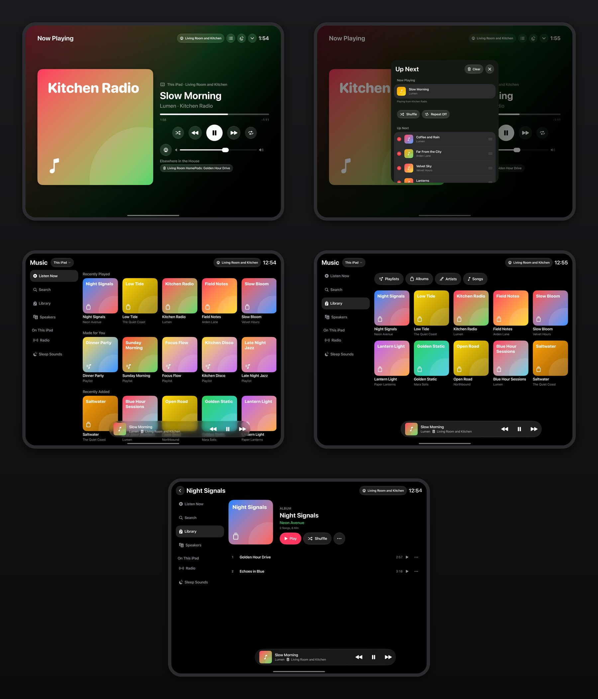

- Apple Music, internet radio (SomaFM, Radio Paradise, KEXP, or search thousands of stations) and generated sleep sounds. Spotify is an optional source through Spotify Connect, off until turned on in Settings.
- Music has Listen Now, Search, a Library of your playlists, albums, artists and songs with a page for each, Speakers, Radio and Sleep Sounds. It opens where you left it.
- A mini player floats at the bottom of every Music page, as in Apple Music, with previous, play or pause and next. Swipe it left or right to skip. Tap it for the full-screen player, and swipe down to come back to the same page.
- The full-screen player has shuffle, repeat, a sleep timer and an Up Next you can reorder. Each person keeps their own queue.
- While music plays, a Now Playing pill sits at the top of every screen with the cover and moving bars. Tap it to open Music with the player up, and Music's back button returns to the app you were in. A running timer sits beside it.
- AirPlay 2 to HomePods, HomePod minis and Sonos, including several speakers at once.
- Pick a preferred speaker and HomePad offers it with one tap whenever something starts playing elsewhere. iOS does not let apps switch speakers silently, so the system picker makes the switch.
- Play straight to a HomePod or Sonos through Home Assistant and Music Assistant, without moving the iPad's audio.
- AirPods: private listening, timer and doorbell chimes in your ears, sleep sounds at night, and nod or shake to answer questions.
- "What's this song?" with Shazam.

## Presence sensing with the Face ID camera

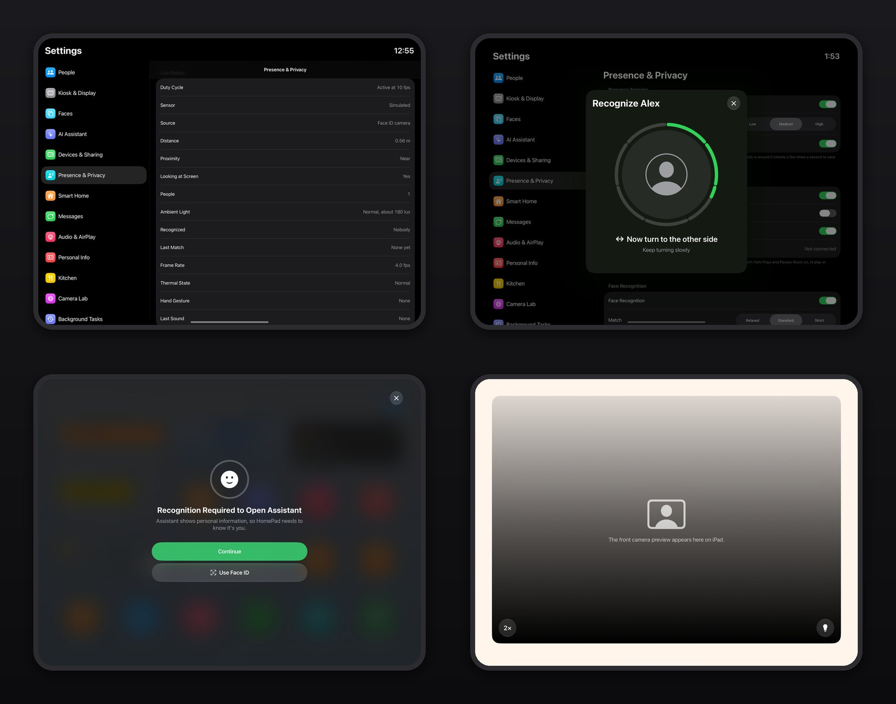

- On Face ID iPads, HomePad uses the infrared TrueDepth camera. It knows whether someone is there, how far away they are and whether they are looking, even in the dark. Other iPads use the regular front camera.
- Hand gestures: hold up an open palm to stop a ringing timer. Pausing and resuming music with the palm is a separate switch, off by default. Both are in Presence settings.
- It listens for smoke alarms, doorbells, knocks, dogs, babies and breaking glass, and shows a full-screen alert for alarms.
- Everything is processed on the iPad. Face templates never leave it and are not backed up.
- It sips power. Sensing runs at a low rate when nobody is around and backs off when the iPad gets warm.
- Mirror: the front camera with a ring light and Close-Up or Full Body views through Center Stage, like HomeView.

## Kitchen

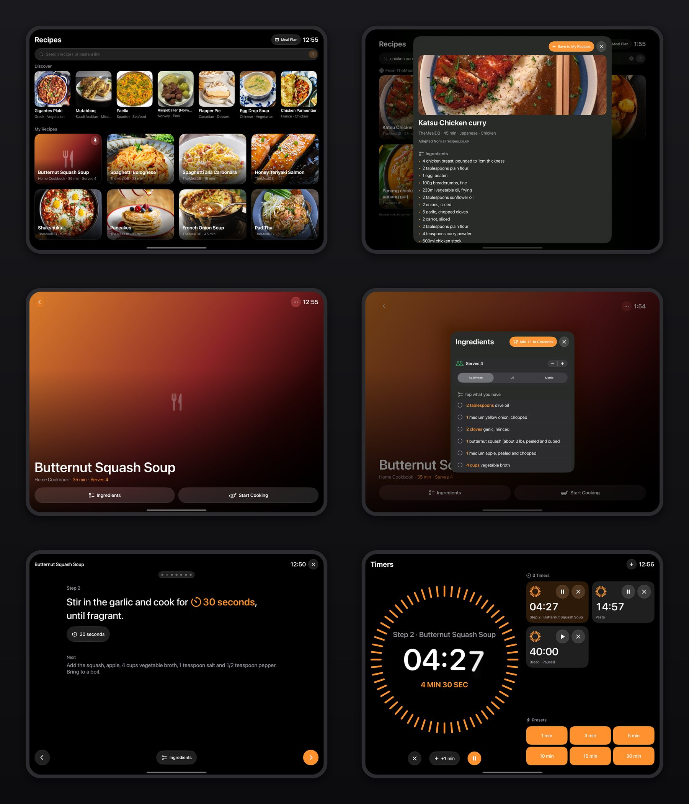

- Paste a recipe link, send one from your iPhone, or scan a recipe card. HomePad turns it into a clean card.
- Cooking mode shows one big step at a time. Amounts are highlighted, times in the text become timer buttons, and the screen stays on. Move on with a swipe or your voice.
- Scale servings, convert units, and send missing ingredients to the Groceries list.
- Multiple named timers with alarms that ring even when HomePad is in the background, and Live Activities on the Lock Screen. The soonest running timer sits at the top of every screen as a small pill with a ring and a countdown, and a tap opens Timers.

## Calendar, reminders, weather, photos and Find My

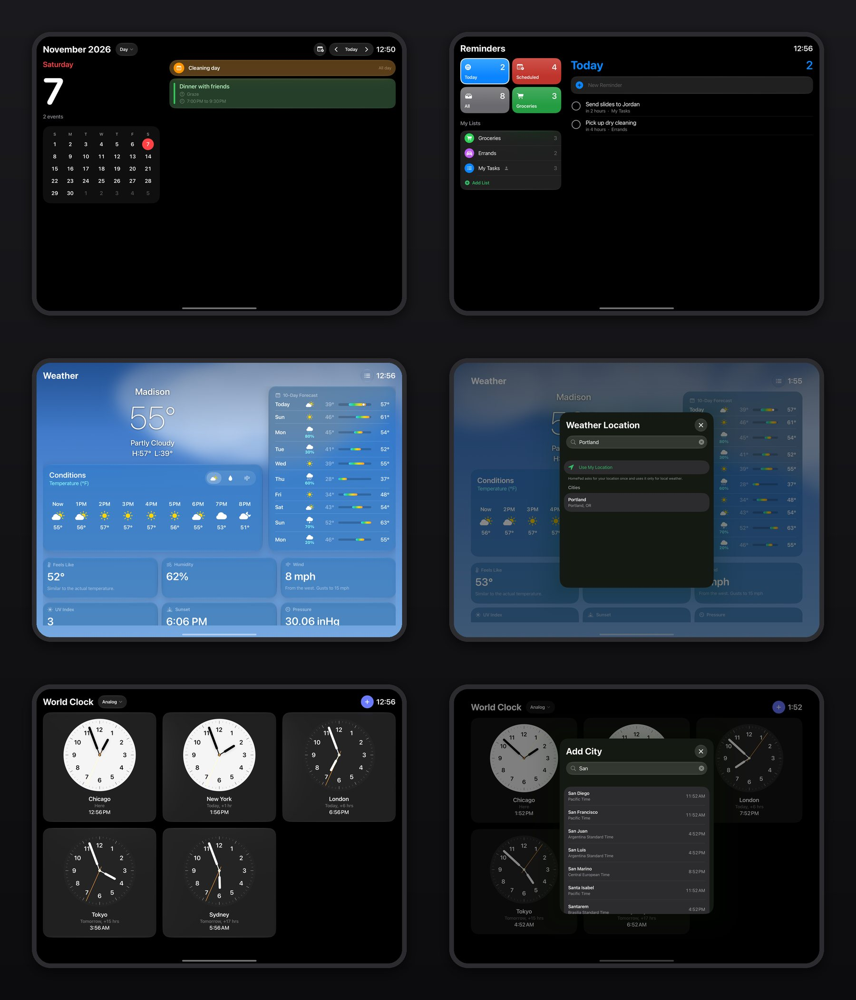

- Calendar and Reminders from the iPad's iCloud account, with each calendar assigned to a person or shared with everyone. Family members share their calendars to the iPad's account once, and HomePad shows each person only their own.
- Reminders reopens on the list you chose last. Otherwise it opens on Today when something is due, and on All otherwise.
- Weather from WeatherKit, with an automatic free fallback. Its text stays readable over bright clouds, and it fits the 11-inch iPad as well as the 13-inch.
- World Clock.
- **Alarms**: each person's wake-up alarms, repeating on the days they choose, with snooze. Only their owner sees them, and they ring full screen for anyone in the room, or as system alarms when HomePad is in the background. Say "set an alarm for 7" or "turn off my alarms".

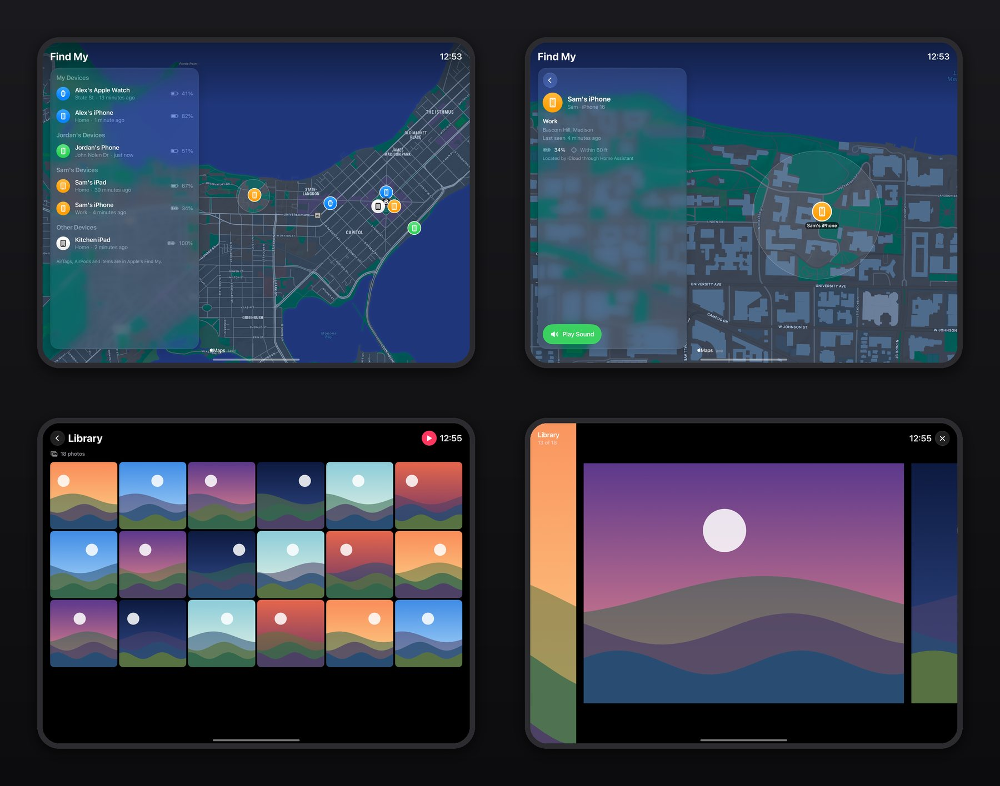

- **Photos**: the library, favorites, albums and iCloud Shared Albums, with videos marked by their length. The library shows only to its owner, picked in Settings > Personal Info, and everyone else in the household sees the Shared Albums. New photos are read as they reach the iPad, so Photos opens with them. A tapped photo grows out of its thumbnail to full screen. Swipe left and right to page, and swipe down to shrink it back into its place. Videos play right there.
- **Your own iPhone's photos**: while HomePad recognizes you, your iPhone's Recents, Favorites and albums show in Photos too, as on HomeView. Turn on Show My Photos once in the HomePad's remote on your iPhone. The HomePad wakes HomePad on the iPhone over Bluetooth, the photos come over your home network only, and they are gone when you walk away.
- **Find My**: the household's iPhones, iPads and watches on a live map, with Play Sound, through Home Assistant's iCloud integration or the Home Assistant app. Each person sees their own devices, and admins see all. Ask "where is everyone's phone" or "ping my iPad". In Settings > Personal Info, an admin picks whose each device is and turns on sharing.

## Messages through your Mac

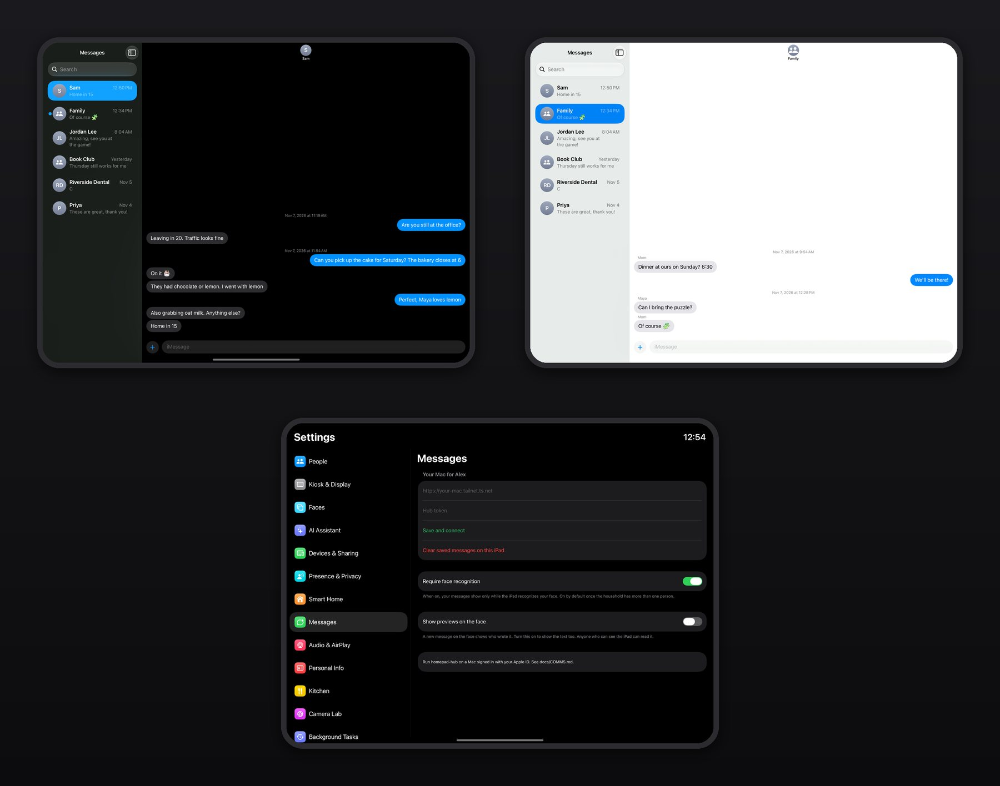

- Read and send iMessage and text messages as each person's own Apple ID. iPadOS gives apps no way into Messages, so a Mac signed in to that Apple ID runs a small tool, `homepad-hub`, that reads Messages and sends through it, and the iPad is the screen. Read state stays in step with your iPhone through Messages in iCloud.
- Conversations and group chats with each sender's name, tapbacks, link cards, and photos as piles or grids that open full screen and save to Photos or Files. Send text and photos.
- A new message shows as a banner on the Home Screen. On the face it shows only who sent it, unless previews are turned on, since the face is read from across the room. The Messages icon carries the unread count.
- One Mac serves the whole household: each person gets their own macOS user on it, signed in to their Apple ID, and connects it in Settings > Messages. Messages show only to the person they belong to, recognized by face, once the household has more than one person.
- The iPad keeps an encrypted copy of recent conversations, so Messages opens at once and still shows them when the Mac is away.

Setting up the Mac is in [docs/COMMS.md](docs/COMMS.md).

## Camera Lab: back-camera tools

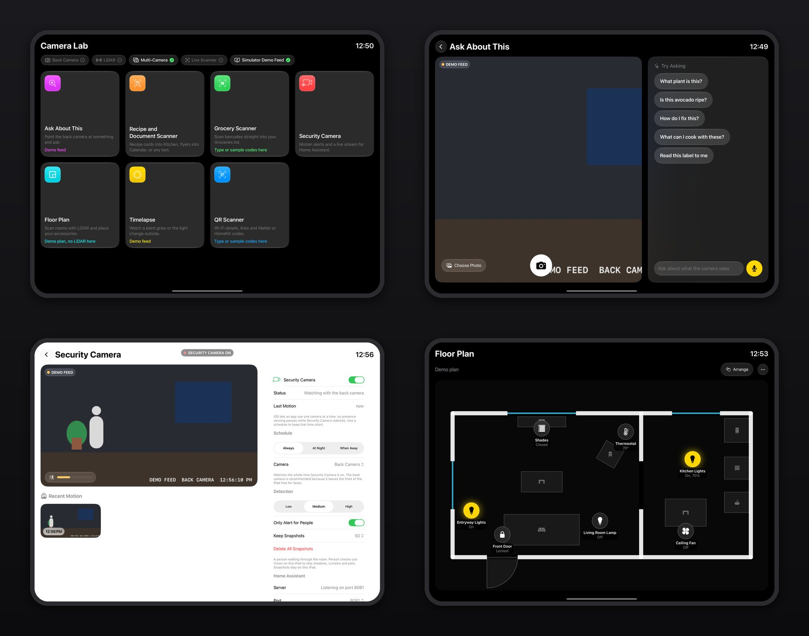

HomeView has no rear camera. HomePad uses the iPad's back cameras and LiDAR:

- **Ask About This**: point the back camera at something and ask, for example "what plant is this?".
- **Recipe and document scanner**: scanned recipe cards go straight into Recipes.
- **Grocery scanner**: scan a barcode to add the product to the Groceries list.
- **Security Camera**: motion detection with person confirmation and a private live stream that Home Assistant can add as a camera. The settings show the exact values to paste.
- **Floor Plan**: scan rooms with LiDAR, place your devices on the plan, and tap them to control.
- **Timelapse** and a **QR scanner** for Wi-Fi, links and Matter codes.

## Across your Apple devices

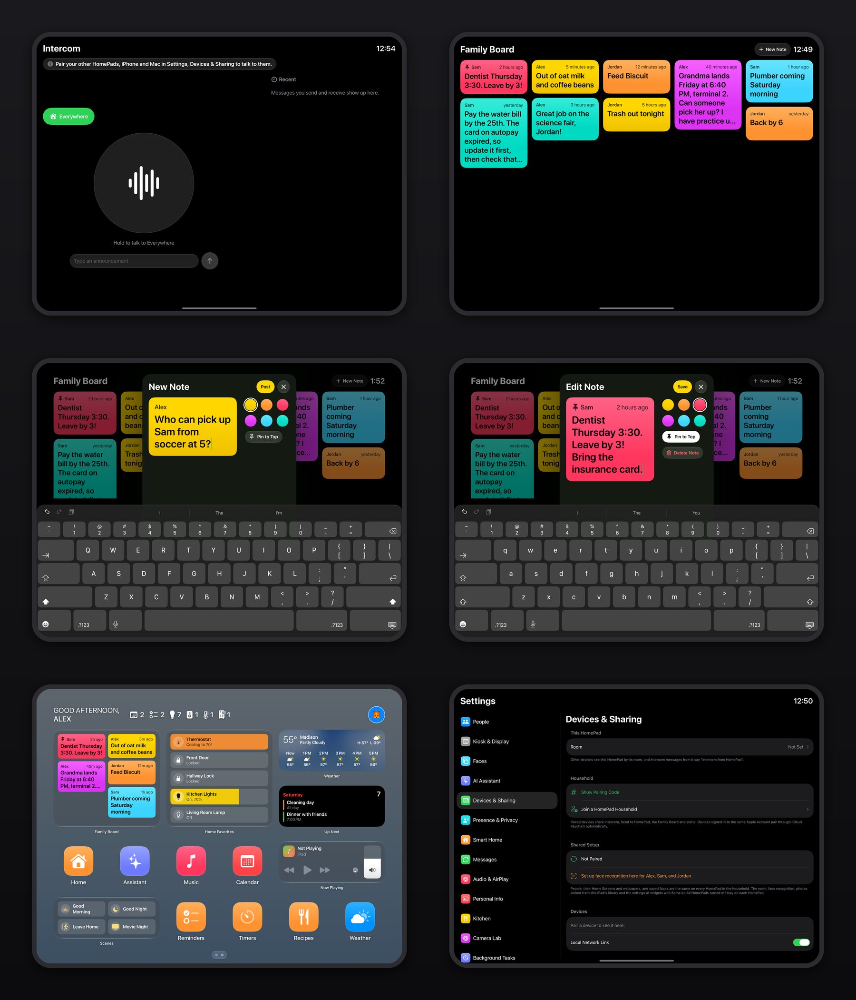

- **Siri**: "Ask HomePad", "Announce with HomePad", "Run Good Night with HomePad" and more, from Siri, Shortcuts, Spotlight and the Action button.
- **Intercom**: talk to one room or every HomePad. Push to talk records a short clip, and it plays with a banner on arrival.
- **iPhone and Mac companion**: the same app becomes a remote. Send recipes, links and photos, talk over intercom, start timers and switch faces, and show your iPhone's photos on a HomePad while it recognizes you. There is a "Send to HomePad" share extension, and an Apple Watch app for intercom, timers and scenes.
- **Music remote**: control each HomePad's music from the iPhone or Mac, like a HomePod in the Home app. Play, pause, skip, change the volume, move the music to other speakers, or search for something to play.
- **Handoff**: continue a recipe or an assistant conversation on your iPhone.
- **Family Board**: shared sticky notes for the household. Each note is sized like a sticky note for its text, and the board lays them out in columns. Its widget shows as many whole notes as fit.
- Devices pair with a 6-digit code, and everything between them is encrypted end to end.
- **Several HomePads, one setup**: paired HomePads show the same people, Home Screens, wallpapers and faces, on one Apple Account or several. Each lays them out on its own screen size. Face recognition is set up on each HomePad, since face data never leaves the iPad that learned it. Settings > Devices & Sharing shows how many HomePads it is synced with and when. A widget's Edit Widget page then has Same on All HomePads: turn it off and each HomePad keeps its own settings for that widget, such as Home Favorites with the kitchen's lights in the kitchen and the bedroom's in the bedroom, while the widget stays in the same place on all of them.

## First setup inside the app

| What | Where |
|---|---|
| AI providers and API keys | Settings > AI Assistant |
| Home Assistant URL and token, HomeKit home | Settings > Smart Home |
| Preferred AirPlay speaker, Music Assistant players, Spotify | Settings > Audio & AirPlay |
| Face enrollment for each person | Settings > Presence & Privacy |
| Each person's Mac user for Messages | Settings > Messages |
| Which calendars belong to whom, Find My devices and sharing | Settings > Personal Info |
| Pair other HomePads and your iPhone | Settings > Devices & Sharing |

API keys are stored in iCloud Keychain, so entering them once on the iPhone companion fills every HomePad.

## Develop

```
make project        # regenerate HomePad.xcodeproj after editing project.yml (needs xcodegen)
make build          # simulator build
make run            # build and launch in the iPad simulator
make test           # unit tests for every package
make ui-test        # UI tests that tap and drag real controls in the simulator
make readme-images  # recapture the screenshots in this README (SIM=<simulator name>)
```

Debug launch arguments open any screen directly, for example `-HomePadOpenApp <id>`, `-HomePadShowFace <id>` and `-HomePadProximity far|mid|near`. Each package README lists its own.

The code is thirteen Swift packages that talk only through shared contracts in `HomePadCore`, and `Hub/`, the Mac tool behind Messages. See [docs/ARCHITECTURE.md](docs/ARCHITECTURE.md) for the rules, [Packages/HomePadUI/DESIGN.md](Packages/HomePadUI/DESIGN.md) for the design system, [docs/APP_ZOOM.md](docs/APP_ZOOM.md) for how apps open and close, and each package's README for details and what still needs on-device testing.

## License

HomePad is source-available under the [PolyForm Noncommercial License 1.0.0](LICENSE.md). Anyone may use, change and share it for noncommercial purposes, such as personal use, study, research and use by charities, schools and public bodies. Commercial use needs a separate license from the copyright holder. It is not an OSI open source license.

The packages in `Packages/ThirdParty` keep their own licenses: KokoroSwift is MIT and MisakiSwift is Apache 2.0, each in its own `LICENSE` file. The Natural voice's bundled voices (`KokoroVoices.npz`) come from Kokoro-82M by hexgrad, under Apache 2.0. Every dependency and its license is listed under Dependencies in [docs/ARCHITECTURE.md](docs/ARCHITECTURE.md#dependencies).
